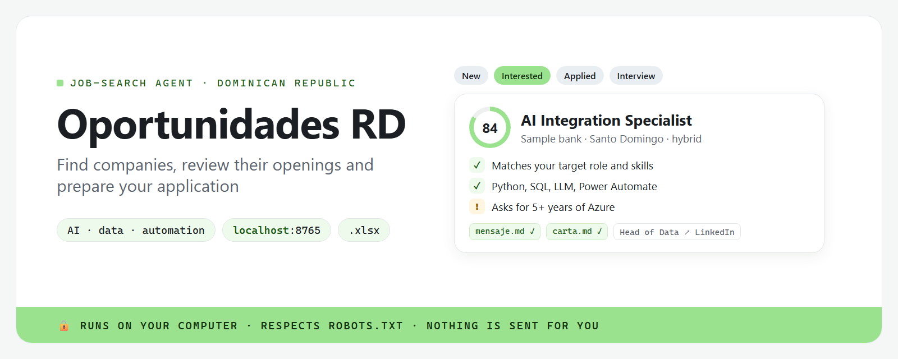

[Español](README.md) · **English**



<p align="center"><strong>An AI agent that helps you find where you could work in the Dominican Republic based on your profile, even if those companies have no open postings: which teams match you, which roles are likely for you, how to apply and whom to contact. Everything runs on your computer, with a dashboard and a spreadsheet.</strong></p>

## What is this?

**Oportunidades RD** ("DR Opportunities") is a "skill" (a package of instructions and tools) that
you install in your AI assistant, such as Claude Code. Tell it *"find companies in the DR for my
profile"* and it:

1. **Gets to know you**: the first time it asks a few questions (what you're looking for, your
   skills, experience, languages, how you want to work, your industries) and saves your profile.
2. **Discovers companies with a verified presence in the DR**: multinationals with operations there
   (offices, regional hubs, shared-service centers, free-zone plants), large local groups,
   fast-growing local companies, and tech companies or startups operating or hiring in the DR.
   Each one carries **at least one source** (company site, news, free-zone directory, official
   registry). If it can't be verified, it isn't added.
3. **Explains why it fits you**, with no numeric score: which **teams** in that company match your
   profile, the **likely roles** for someone like you (with a reason), **evidence** that those teams
   exist in the DR (past or current postings, pages, news), the **3 main reasons** and the **red
   flags** (only on-site plant roles, requires skills you lack, no hybrid…).
4. **Tells you how to apply**: careers portal (filtered to the DR when possible), talent pool or
   general application, the company's LinkedIn page, and 2–3 **job titles** to contact, each with a
   LinkedIn people-search link you open yourself.
5. **Checks for open postings** as a secondary signal: it politely visits their career pages and
   says "hay vacantes" (openings) or "no hay" (none).
6. **You choose.** Only for companies you mark "Me interesa" (interested) does it draft a **short
   message** and a **general application letter**, tailored to the matched team and likely role and
   linking to your work.
7. **You stay on top of it** with a dashboard and an Excel file: Descubierta (discovered) → Me
   interesa → Investigando (researching) → Contacté (contacted) → Aplicado (applied) → Entrevista
   (interview) → Oferta (offer) / Descartada (discarded), with dates and notes.

The app's interface is in Spanish.

## Who is it for?

Anyone looking for work in the Dominican Republic, in any field: the search starts from **your**
profile (roles, skills, experience, industries and preferences). You don't need to know how to
code: the AI assistant handles the technical part.

> [!IMPORTANT]
> **Everything stays on your computer.** Your profile and companies are local files.
> There is no Oportunidades RD account or server.
> **Nothing is sent for you.** The message and the letter are saved as files; you review and send them.
> **It never crawls LinkedIn, Computrabajo or Indeed.** If you see a posting there, paste it yourself.
> **It stores no personal data about people.** For "who to contact" it only suggests **job titles**
> and gives you a LinkedIn search link that you open yourself.
> **Check before you write.** Your agent does the research with web searches: review each company's sources.

## How to use it (the easy way)

1. **Ask your AI assistant to install it.** If you use Claude Code or another AI agent, paste:

   ```text
   Install the oportunidades-rd skill from https://github.com/alejandrocimentada/oportunidades-rd and open the dashboard for me.
   ```

   <details>
   <summary><b>Don't have an AI agent? Start here (5 minutes)</b></summary>

   1. **What an AI agent is:** an assistant, like Claude Code, that can work with files on your
      computer: read them, run programs and explain the results.
   2. **Open the terminal**: on Windows press the Windows key, type "PowerShell" and open it; on a
      Mac press Cmd + Space, type "Terminal" and open it.
   3. **Install Claude Code** following the
      [official quickstart](https://code.claude.com/docs/en/quickstart) (steps 1 and 2).
   4. **Type `claude`** and press Enter. The first time it asks you to sign in. Then paste the message above.

   </details>

2. **Fill in your profile**: in the conversation, or in the dashboard's **Mi perfil** tab (eight
   short questions). It's saved in `~/.config/oportunidades-rd/profile.yaml`, outside the project folder.

3. **Ask for what you need**, in your own words:

   > Find companies in the DR for my profile.
   > Which teams at Company X match me? What am I missing?
   > Check whether they have open postings.
   > Mark Company X as "Me interesa" and draft the message and letter for the BI Analyst role.
   > Move Company X to "Contacté": I wrote to Talent Acquisition.
   > Open the dashboard.

## The dashboard

Ask the assistant to *"open the dashboard"*, or run `python app.py` in the project folder. It opens
at <http://localhost:8765> (only your computer can see it).

- **Mi perfil**: the eight profile questions, step by step.
- **Resumen**: companies per status, the latest discovered, contacts this week, upcoming follow-ups
  and open postings from the last check.
- **Tablero**: one column per status; **drag a company** to change it.
- **Empresas**: filters by status, type, industry and "only with open postings".
- **Vacantes**: postings the crawler found (secondary check).
- **Company detail**: DR presence with sources, teams, likely roles, evidence, why it fits, red flags,
  how to apply, whom to contact, open postings, the message and letter with a **Copy** button, your
  notes and the dated history.

*(The screenshots in `docs/` are from an earlier version and use made-up data.)*

## For technical users

**oportunidades-rd** is a skill for AI agents (Claude Code, Codex and other agents that support
`SKILL.md`) plus a small Python app: command-line scripts, a SQLite database, a Flask dashboard and
an Excel export. The agent follows [`SKILL.md`](SKILL.md): it discovers and analyzes companies with
web searches and saves them with `scripts/empresas.py guardar`.

### Manual installation

Requirements: Python 3.10+ and `pip`. Copy the repository into `~/.claude/skills/oportunidades-rd`
(Claude Code) or `~/.codex/skills/oportunidades-rd` (Codex) and run
`pip install -r requirements.txt` there. Optional, to draft via API: `pip install anthropic` or
`pip install openai`.

### A full walkthrough

```bash
python scripts/perfil.py show                          # 1. no profile → the agent asks and saves with `set`
python scripts/empresas.py contexto --json             # 2. profile + saved companies (to avoid repeats)
python scripts/empresas.py guardar --archivo empresas.json   # 3. the agent saves its research
python scripts/rastrear.py                             # 4. any open postings? (secondary)
python scripts/empresas.py list                        # 5. you choose
python scripts/empresas.py estado "Company X" "Me interesa"
python scripts/empresas.py generar "Company X" --rol "BI Analyst"   # 6. message + letter (or the agent: guardar-texto)
python app.py                                          # 7. dashboard at http://localhost:8765
```

The JSON format for companies (one object or a list) is documented in [`README.md`](README.md) and
[`SKILL.md`](SKILL.md). Without `fuentes_presencia` holding a valid link, a company **is not saved**.
To try it without your data: `python scripts/demo.py`, then `python app.py --demo`.

Public demo (GitHub Pages): `python scripts/construir_demo.py` writes a static copy of the dashboard with made-up
data to `docs/` (no server, nothing is saved). Re-run it after changing `templates/` or `static/`; on GitHub,
Settings → Pages → branch `master`, folder `/docs`.

### How postings are checked

Robots.txt is respected; at most one request every 3 seconds per site; 24-hour cache; a clear
User-Agent; public ATS feeds (Greenhouse, Lever, Workable, SmartRecruiters, Teamtailor, BambooHR) and
SAP SuccessFactors' public search page; pages that need JavaScript or a login are marked "abrir
manualmente" (open manually) with the link. Job boards (LinkedIn, Computrabajo, Indeed, Glassdoor…)
are never crawled.

### Drafting with AI

`ia.proveedor` in the profile: `agente` (default: the agent researches and drafts), `claude`
(`ANTHROPIC_API_KEY`, default model `claude-sonnet-5-5`), `openai` (`OPENAI_API_KEY`, default `gpt-5`)
or `ninguno` (templates). Only the profile (no paths or settings) and the company data are sent, and
only to the chosen provider.

### Data

The profile lives in `~/.config/oportunidades-rd/profile.yaml`; everything else in `data/`
(`oportunidades.db`, `oportunidades.xlsx`, `documentos/`, `cache/`), which is git-ignored. Contacts
are stored only as job titles; anything that looks like an email, phone number or personal profile
link is rejected. A database from the previous version (scored postings) is backed up as
`oportunidades.v1-<date>.db` and a new one is started.

### Development

```bash
pip install -r requirements.txt pytest
python -m pytest
```

Tests use saved pages in `tests/fixtures/` and never go online.

## Disclaimer

Independent project, not affiliated with LinkedIn, Computrabajo, Indeed, Greenhouse, Lever, Workable,
SmartRecruiters, Teamtailor, BambooHR, SAP, Anthropic or OpenAI. Companies in the examples and the
demo are made up.

## License

[MIT](LICENSE) © 2026 Alejandro Cimentada.
