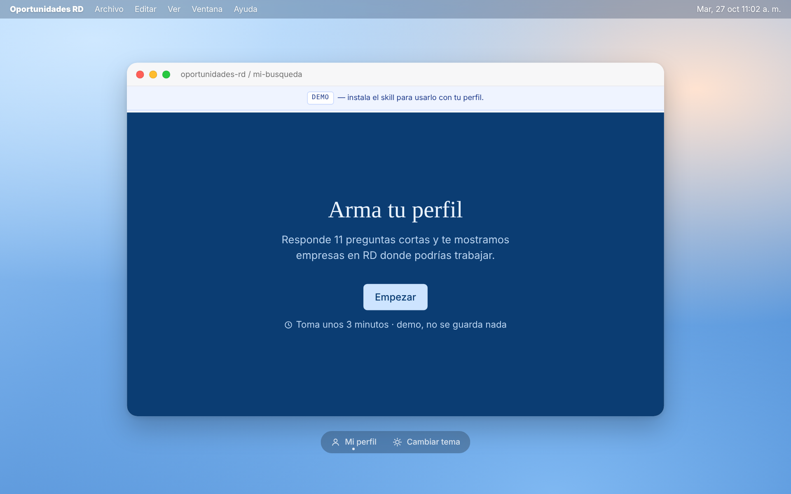

[Español](README.md) · **English**


<p align="center"><strong>An AI agent that helps you find where you could work in the Dominican Republic based on your profile, even if those companies have no open postings: which teams match you, which roles are likely for you, how to apply and whom to contact. Everything runs on your computer.</strong></p>

## What is this?

**Oportunidades RD** ("DR Opportunities") is a "skill" (a package of instructions and tools) that
you install in your AI assistant, such as Claude Code. Tell it *"find companies in the DR for my
profile"* and it:

1. **Gets to know you**: the first time it asks a few questions (what you're looking for, your
   skills, experience, languages, how you want to work) and saves your profile. It suggests skills and
   roles from your interests and experience, each with a reason, and you pick.
2. **Discovers companies with a verified presence in the DR**: multinationals with operations there
   (offices, regional hubs, shared-service centers, free-zone plants), large local groups,
   fast-growing local companies, and tech companies or startups operating or hiring in the DR.
   Each one carries **at least one source** (company site, news, free-zone directory, official
   registry). If it can't be verified, it isn't added.
3. **Explains why it fits you**, with no numeric score: which **teams** in that company match your
   profile, the **likely roles** for someone like you (with a reason), **evidence** that those teams
   exist in the DR (past or current postings, pages, news), the **3 main reasons** and the **red
   flags** (only on-site plant roles, requires skills you lack, no hybrid…).
4. **Tells you how to apply**: careers portal (filtered to the DR when possible), talent pool or
   general application, the company's LinkedIn page, and 2–3 **job titles** to contact, each with a
   LinkedIn people-search link you open yourself.
5. **Checks for open postings** as a secondary signal: it politely visits their career pages and
   says "hay vacantes" (openings) or "no hay" (none).
6. **You choose.** Only for companies you mark "Me interesa" (interested) does it draft a **short
   message** and a **general application letter**, tailored to the matched team and likely role and
   linking to your work.
7. **You stay on top of it** with your agent and an Excel file that updates itself: Descubierta (discovered) → Me
   interesa → Investigando (researching) → Contacté (contacted) → Aplicado (applied) → Entrevista
   (interview) → Oferta (offer) / Descartada (discarded), with dates and notes.

The app's interface is in Spanish.

## Who is it for?

Anyone looking for work in the Dominican Republic, in any field: the search starts from **your**
profile (interests, experience, skills, roles and preferences). You don't need to know how to
code: the AI assistant handles the technical part.

> [!IMPORTANT]
> **Everything stays on your computer.** Your profile and companies are local files.
> There is no Oportunidades RD account or server.
> **Nothing is sent for you.** The message and the letter are saved as files; you review and send them.
> **It never crawls LinkedIn, Computrabajo or Indeed.** If you see a posting there, paste it yourself.
> **It stores no personal data about people.** For "who to contact" it only suggests **job titles**
> and gives you a LinkedIn search link that you open yourself.
> **Check before you write.** Your agent does the research with web searches: review each company's sources.

## How to use it (the easy way)

1. **Ask your AI assistant to install it.** If you use Claude Code or another AI agent, paste:

   ```text
   Install the oportunidades-rd skill from https://github.com/alejandrocimentada/oportunidades-rd and open the panel for me.
   ```

   <details>
   <summary><b>Don't have an AI agent? Start here (5 minutes)</b></summary>

   1. **What an AI agent is:** an assistant, like Claude Code, that can work with files on your
      computer: read them, run programs and explain the results.
   2. **Open the terminal**: on Windows press the Windows key, type "PowerShell" and open it; on a
      Mac press Cmd + Space, type "Terminal" and open it.
   3. **Install Claude Code** following the
      [official quickstart](https://code.claude.com/docs/en/quickstart) (steps 1 and 2).
   4. **Type `claude`** and press Enter. The first time it asks you to sign in. Then paste the message above.

   </details>

2. **Fill in your profile**: in the conversation, or in the panel your agent opens for you (about 11
   short questions, one at a time; it takes about 3 minutes). Skip anything you don't know. It's saved
   when you finish, in `~/.config/oportunidades-rd/profile.yaml`, outside the project folder.

3. **Ask for what you need**, in your own words:

   > Find companies in the DR for my profile.
   > Which teams at Company X match me? What am I missing?
   > Check whether they have open postings.
   > Mark Company X as "Me interesa" and draft the message and letter for the BI Analyst role.
   > Move Company X to "Contacté": I wrote to Talent Acquisition.
   > Open the panel.
   > Which companies do I have saved, and what status is each one in?

## The panel

Ask the assistant to *"open the panel"*, or run `python app.py` in the project folder. It opens at
<http://localhost:8765> (only your computer can see it). You can try the
[demo](https://alejandrocimentada.github.io/oportunidades-rd/) before installing it (it saves nothing).



- **Arma tu perfil** (build your profile): one question at a time; Enter moves on and ↑ goes back. If
  you have no work experience, the experience questions are skipped.
- **Suggested skills and roles** come from the areas you picked, without AI (a local map); your agent
  can refine them. For roles you can choose *"No sé todavía"* (I don't know yet).
- **At the end** you see a summary of your answers (tap one to change it) and, with **Continuar**, what
  to ask your agent next.
- **The form starts blank** every time you open the page and is saved only when you finish, so leaving
  halfway never changes the profile you already had.


Ask your agent for your companies, their analysis, drafts and follow-ups in the conversation; all of it
is also in the Excel file.

## For technical users

**oportunidades-rd** is a skill for AI agents (Claude Code, Codex and other agents that support
`SKILL.md`) plus a small Python app: command-line scripts, a SQLite database, a local Flask panel (the profile survey) and
an Excel export. The agent follows [`SKILL.md`](SKILL.md): it discovers and analyzes companies with
web searches and saves them with `scripts/empresas.py guardar`.

### Manual installation

Requirements: Python 3.10+ and `pip`. Copy the repository into `~/.claude/skills/oportunidades-rd`
(Claude Code) or `~/.codex/skills/oportunidades-rd` (Codex) and run
`pip install -r requirements.txt` there. Optional, to draft via API: `pip install anthropic` or
`pip install openai`.

### A full walkthrough

```bash
python scripts/perfil.py show                          # 1. no profile → the agent asks and saves with `set`
python scripts/empresas.py contexto --json             # 2. profile + saved companies (to avoid repeats)
python scripts/empresas.py guardar --archivo empresas.json   # 3. the agent saves its research
python scripts/rastrear.py                             # 4. any open postings? (secondary)
python scripts/empresas.py list                        # 5. you choose
python scripts/empresas.py estado "Company X" "Me interesa"
python scripts/empresas.py generar "Company X" --rol "BI Analyst"   # 6. message + letter (or the agent: guardar-texto)
python app.py                                          # 7. panel at http://localhost:8765
```

The JSON format for companies (one object or a list) is documented in [`README.md`](README.md) and
[`SKILL.md`](SKILL.md). Without `fuentes_presencia` holding a valid link, a company **is not saved**.
To try it without your data: `python scripts/demo.py`, then `python app.py --demo`.

Public demo (GitHub Pages): `python scripts/construir_demo.py` writes a static copy of the panel with made-up
data to `docs/` (no server, nothing is saved). Re-run it after changing `templates/` or `static/`; on GitHub,
Settings → Pages → branch `main`, folder `/docs`.

### How postings are checked

Robots.txt is respected; at most one request every 3 seconds per site; 24-hour cache; a clear
User-Agent; public ATS feeds (Greenhouse, Lever, Workable, SmartRecruiters, Teamtailor, BambooHR) and
SAP SuccessFactors' public search page; pages that need JavaScript or a login are marked "abrir
manualmente" (open manually) with the link. Job boards (LinkedIn, Computrabajo, Indeed, Glassdoor…)
are never crawled.

### Drafting with AI

`ia.proveedor` in the profile: `agente` (default: the agent researches and drafts), `claude`
(`ANTHROPIC_API_KEY`, default model `claude-sonnet-5-5`), `openai` (`OPENAI_API_KEY`, default `gpt-5`)
or `ninguno` (templates). Only the profile (no paths or settings) and the company data are sent, and
only to the chosen provider.

### Data

The profile lives in `~/.config/oportunidades-rd/profile.yaml`; everything else in `data/`
(`oportunidades.db`, `oportunidades.xlsx`, `documentos/`, `cache/`), which is git-ignored. Contacts
are stored only as job titles; anything that looks like an email, phone number or personal profile
link is rejected. A database from the previous version (scored postings) is backed up as
`oportunidades.v1-<date>.db` and a new one is started.

### Development

```bash
pip install -r requirements.txt pytest
python -m pytest
```

Tests use saved pages in `tests/fixtures/` and never go online.

## Disclaimer

Independent project, not affiliated with LinkedIn, Computrabajo, Indeed, Greenhouse, Lever, Workable,
SmartRecruiters, Teamtailor, BambooHR, SAP, Anthropic or OpenAI. Companies in the examples and the
demo are made up.

## Credits: ESCO

> This service uses the ESCO classification of the European Commission.

The skills search (the skills question) and part of the skill and role suggestions use **ESCO**, the European
classification of Skills, Competences, Qualifications and Occupations, by the **European Commission**
(<https://esco.ec.europa.eu/en>), version v1.2.1, licensed under
[CC BY 4.0](https://creativecommons.org/licenses/by/4.0/).

- **Adapted version:** `static/esco.json` is not the full ESCO. `scripts/construir_esco.py` builds it from the
  official Spanish and English CSV files (released concepts only), as a profile-style skills list: short names
  instead of task sentences:
  - **ESCO subset:** "knowledge" skills of up to 4 words used by at least one occupation, without suffixes such as
    "(computer programming)".
  - **Rewritten labels:** the most used transversal competences (40+ occupations), rewritten as short names in
    `scripts/habilidades/competencias_esco.json` ("perform project management" → "Project management"); those that
    don't work as a profile skill are dropped. It also holds a few other ESCO skills with short names, which curated
    skills point to ("use customer relationship management software" → "CRM"). They keep their ESCO URI.
  - **Curated skills, not from ESCO:** current tools and methods (Excel, Power BI, Salesforce, Scrum, ChatGPT…) and
    soft skills, in `scripts/habilidades/curadas.json`; marked `curada` in the index. When an ESCO skill is a clear
    equivalent, the curated skill names it in `esco_equivalente` (Excel → spreadsheets, Power BI → business
    intelligence, Salesforce → CRM) and counts as it when suggesting occupations.
  - For each occupation, its labels and up to 15 essential skills from this list. The original CSV files (~95 MB)
    are not in the repository.
- The European Commission does not endorse this project. Per ESCO's copyright notice, part of its
  skills hierarchy is based on O\*NET OnLine (USDOL/ETA, CC BY 4.0) and other sources; this index
  does not include that hierarchy, only skill labels.
- To update it, download the classification at <https://esco.ec.europa.eu/en/use-esco/download>
  (CSV, Spanish and English; ESCO emails the link), unzip it into `data/esco/es` and `data/esco/en`
  and run `python scripts/construir_esco.py --origen data/esco/es --origen data/esco/en --version v1.2.1`, then
  `python scripts/construir_demo.py`.

## License

[MIT](LICENSE) © 2026 Alejandro Cimentada.
