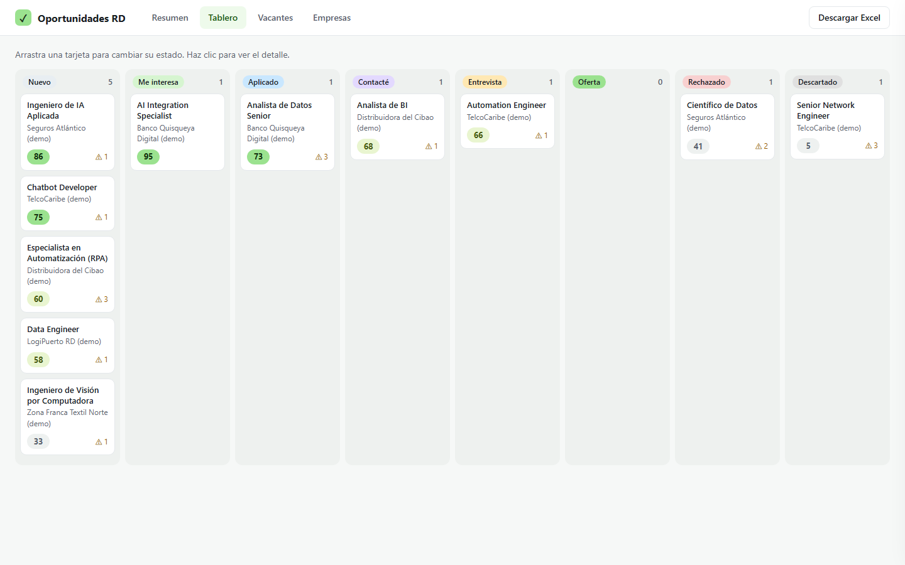
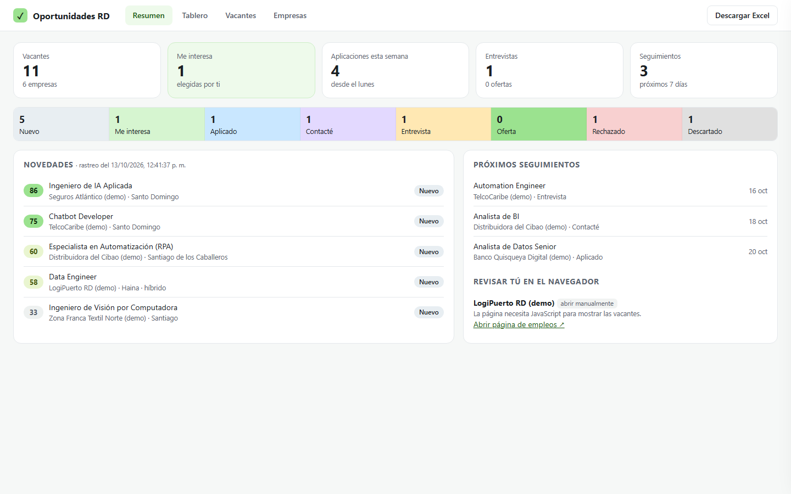
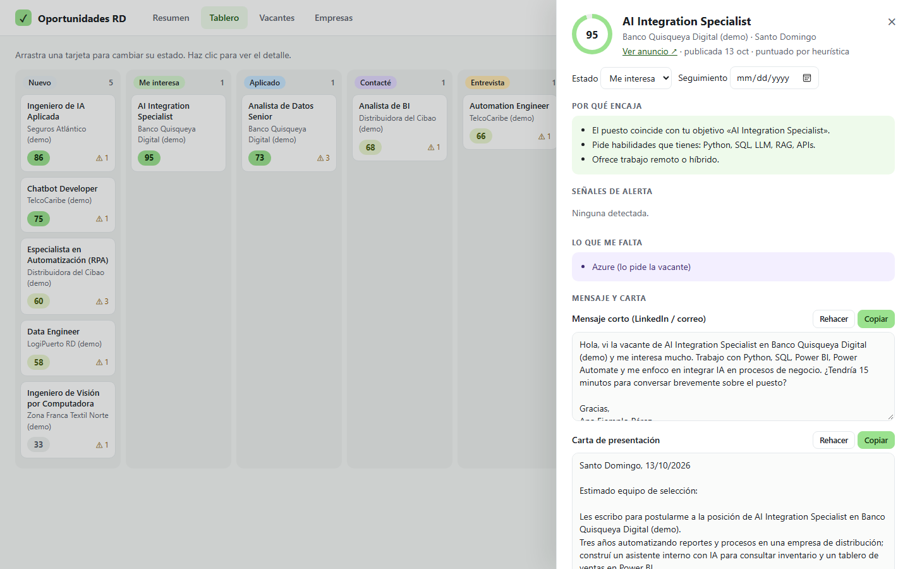

**Español** · [English](README.en.md)


<p align="center"><strong>Un agente de IA que te ayuda a buscar empleo en la República Dominicana: encuentra empresas donde podrías trabajar, revisa sus páginas de empleo, te dice qué vacantes encajan contigo y por qué, y te prepara el mensaje y la carta. Todo en tu computadora, con un tablero y un Excel.</strong></p>

## ¿Qué es esto?

**Oportunidades RD** es un "skill" (un paquete de instrucciones y herramientas) que se instala en
tu asistente de IA, como Claude Code. Le dices *"búscame trabajo de IA en RD"* y:

1. **Te conoce**: la primera vez te hace unas preguntas (qué buscas, qué sabes hacer, cuánto
   quieres ganar) y guarda tu perfil en tu computadora.
2. **Busca empresas**: banca, telecomunicaciones, distribución, seguros, zonas francas, logística,
   turismo, tecnología, gobierno digital… Te dice por qué cada una podría interesarte, aunque no
   tenga vacantes abiertas, y qué **cargos** contactar (por ejemplo "Head of Data").
3. **Revisa sus páginas de empleo**, con educación: respeta las reglas de cada sitio, va despacio y
   nunca entra a lugares con contraseña.
4. **Te dice qué tan bien encaja cada vacante** (de 0 a 100), por qué, qué **señales de alerta**
   tiene (pide 7 años de experiencia, es solo presencial, paga menos de tu mínimo…) y **qué te falta**.
5. **Tú eliges.** Solo para las vacantes que marcas "Me interesa", prepara un **mensaje corto** para
   LinkedIn o correo y una **carta de presentación**, en español o inglés según el anuncio.
6. **Llevas el control** en un tablero en tu navegador y en un Excel: qué está nuevo, a qué
   aplicaste, a quién contactaste, cuándo dar seguimiento.

## ¿Para quién es?

Para quien busca empleo en la República Dominicana, sobre todo en IA, automatización y datos (puedes
cambiar los roles en tu perfil). No necesitas saber programar: el asistente de IA hace la parte técnica.

> [!IMPORTANT]
> **Todo queda en tu computadora.** Tu perfil, las empresas y las vacantes se guardan en archivos
> locales. No hay cuenta ni servidor de Oportunidades RD.
> **Nada se envía solo.** El mensaje y la carta se guardan como archivos; tú los revisas y los envías.
> **No entra a LinkedIn, Computrabajo ni Indeed.** Esas vacantes las copias y las pegas tú (ver abajo).
> **No guarda datos de personas.** Para "a quién contactar" solo sugiere **cargos** y te da un
> enlace de búsqueda de LinkedIn que abres tú, con tu cuenta.
> **La puntuación es una ayuda, no una verdad.** Léela con criterio, sobre todo la heurística sin IA.

## Cómo usarlo (la forma más fácil)

1. **Pídele a tu asistente de IA que lo instale.** Si usas Claude Code u otro agente de IA
   (un asistente que puede trabajar con archivos en tu computadora), copia y pega este mensaje:

   ```text
   Instala el skill oportunidades-rd desde https://github.com/alejandrocimentada/oportunidades-rd
   ```

   <details>
   <summary><b>¿No tienes un agente de IA? Así empiezas (5 minutos)</b></summary>

   1. **Qué es un agente de IA:** un asistente, como Claude Code, que puede trabajar con archivos
      en tu computadora: leerlos, ejecutar programas y explicarte los resultados.
   2. **Abre la terminal** (la ventana donde se escriben comandos):
      - Windows: presiona la tecla Windows, escribe "PowerShell" y ábrelo.
      - Mac: presiona Cmd + Espacio, escribe "Terminal" y ábrela.
   3. **Instala Claude Code** siguiendo la
      [guía oficial de inicio rápido](https://code.claude.com/docs/es/quickstart) (pasos 1 y 2).
      Necesitarás una cuenta de Claude; la guía explica qué planes incluyen Claude Code.
   4. **Escribe `claude`** y presiona Enter para abrir el agente. La primera vez te pedirá
      iniciar sesión con tu cuenta de Claude. Luego pega el mensaje del paso 1.

   </details>

2. **Responde unas preguntas la primera vez.** Por ejemplo: qué puestos buscas, tus habilidades y
   años de experiencia, idiomas, si prefieres trabajar algunos días desde casa, tu salario mínimo
   en pesos y tus enlaces (portafolio, GitHub). Si no sabes algo, di "no sé" y sigue.
   Tus respuestas se guardan en `~/.config/oportunidades-rd/profile.yaml`, fuera de la carpeta del proyecto.

3. **Pídele lo que necesites**, con tus palabras:

   > Búscame empresas en RD donde pueda trabajar integrando IA.
   > Revisa sus páginas de empleo y dime qué hay de nuevo.
   > ¿Cuáles vacantes encajan mejor conmigo? ¿Qué me falta para la de TelcoX?
   > Marca la 12 como "Me interesa" y prepárame el mensaje y la carta.
   > Encontré esta vacante en LinkedIn: *(pegas el texto)*
   > Abre el tablero.

## El tablero

Pídele al asistente *"abre el tablero"*, o escribe `python app.py` en la carpeta del proyecto.
Se abre en tu navegador en <http://localhost:8765> (solo tu computadora puede verlo).



- **Resumen**: cuántas vacantes hay en cada estado, aplicaciones de esta semana, novedades del
  último rastreo, próximos seguimientos y páginas que debes abrir tú.
- **Tablero**: una columna por estado. **Arrastra una tarjeta** para cambiarla de estado.
- **Vacantes**: lista con filtros por ajuste, empresa y estado.
- **Empresas**: interés, página de empleos y los cargos a contactar con su búsqueda de LinkedIn.
- **Detalle** de cada vacante: por qué encaja, señales de alerta, lo que te falta, el mensaje y la
  carta con botón **Copiar**, tus notas y el historial con fechas.

| Resumen | Detalle de una vacante |
|---|---|
|  |  |

*(Las capturas usan empresas y vacantes inventadas.)*

## El Excel

`data/oportunidades.xlsx` se actualiza solo después de cada cambio. Tiene cuatro hojas, con filtros,
encabezados fijos y colores por estado: **Resumen**, **Empresas**, **Vacantes** y **Seguimiento**
(cada cambio de estado con su fecha). También puedes bajarlo desde el botón *Descargar Excel* del tablero.
Si lo tienes abierto en Excel mientras haces cambios, ciérralo para que se pueda actualizar.

## Estados de una vacante

**Nuevo** → **Me interesa** → **Aplicado** → **Contacté** → **Entrevista** → **Oferta**, o
**Rechazado** / **Descartado**. Cada cambio guarda la fecha. Al pasar a *Aplicado*, *Contacté* o
*Entrevista* se agenda un recordatorio de seguimiento (7, 5 y 3 días); puedes cambiarlo.

## Vacantes de LinkedIn, Computrabajo o Indeed

Esos portales no se revisan automáticamente (sus reglas no lo permiten y piden iniciar sesión).
Copia el texto del anuncio y pégalo en la conversación con tu asistente, con el enlace si lo
tienes. El asistente lo guarda, revisa que no esté repetido y te da la puntuación.

## Glosario

- **Vacante**: un puesto de trabajo publicado.
- **Ajuste (0–100)**: qué tan bien encaja la vacante con tu perfil.
- **Señales de alerta**: cosas que podrían no convenirte (experiencia que no tienes, solo presencial, salario bajo, anuncio vago).
- **Página de empleos**: la sección "Trabaja con nosotros" o "Careers" del sitio de una empresa.
- **ATS**: el sistema que muchas empresas usan para publicar vacantes (Greenhouse, Lever, Workable…). Algunos tienen una lista pública que se puede leer de forma ordenada.
- **robots.txt**: un archivo donde cada sitio web dice qué partes no deben revisar los programas. Oportunidades RD lo respeta.
- **Rastreo**: cuando el programa visita las páginas de empleo para ver qué vacantes hay.
- **Seguimiento**: el recordatorio para volver a escribir si no te han respondido.

## Preguntas frecuentes

**¿Me postula solo o envía mensajes por mí?**
No. Prepara los textos; tú decides si los envías y a quién.

**¿Dónde están mis datos? ¿Quién los ve?**
En tu computadora: el perfil en `~/.config/oportunidades-rd/` y lo demás en la carpeta `data/` del
proyecto. Si eliges usar una IA con tu propia clave (Claude u OpenAI), tu perfil y el texto de la
vacante se envían **solo** a ese proveedor para puntuar y redactar. Con la opción por defecto
("agente"), el trabajo lo hace tu propio asistente. Con "ninguno", nada sale de tu computadora
(salvo las visitas a las páginas de empleo).

**¿Cuesta dinero?**
El proyecto es gratis. Tu asistente de IA puede tener costo según tu plan, y si usas una clave de
API de Claude u OpenAI, pagas a ese proveedor según el uso.

**¿Por qué una empresa dice "abrir manualmente" o "revisar manualmente"?**
"Revisar manualmente" significa que el sitio pide que los programas no visiten esa página
(robots.txt). "Abrir manualmente" significa que la página necesita JavaScript o iniciar sesión.
En ambos casos te damos el enlace para que la abras tú en el navegador.

**¿Por qué no aparece una vacante que veo en la página?**
Algunas páginas cargan las vacantes de formas que el programa no sabe leer. Ábrela y pega la vacante
en la conversación.

**¿Necesito saber programar?**
No, si usas un agente de IA como Claude Code. El agente se encarga de los comandos.

---

## Para usuarios técnicos

**oportunidades-rd** es una skill para agentes de IA (Claude Code, Codex y otros agentes
compatibles con `SKILL.md`) más una pequeña aplicación en Python: scripts de línea de comandos,
una base SQLite, un tablero Flask y exportación a Excel. El agente sigue [`SKILL.md`](SKILL.md):
hace las búsquedas web para descubrir empresas y, en modo `agente`, puntúa y redacta él mismo.

### Instalación manual

Requisitos: Python 3.10 o superior y `pip`.

**Claude Code (macOS / Linux)**

```bash
git clone https://github.com/alejandrocimentada/oportunidades-rd.git
mkdir -p ~/.claude/skills/oportunidades-rd
cp -R oportunidades-rd/. ~/.claude/skills/oportunidades-rd/
pip install -r ~/.claude/skills/oportunidades-rd/requirements.txt
```

**Claude Code (Windows PowerShell)**

```powershell
git clone https://github.com/alejandrocimentada/oportunidades-rd.git
New-Item -ItemType Directory -Force "$HOME\.claude\skills\oportunidades-rd" | Out-Null
Copy-Item -Recurse -Force "oportunidades-rd\*" "$HOME\.claude\skills\oportunidades-rd\"
pip install -r "$HOME\.claude\skills\oportunidades-rd\requirements.txt"
```

**Codex**

```bash
git clone https://github.com/alejandrocimentada/oportunidades-rd.git
mkdir -p ~/.codex/skills/oportunidades-rd
cp -R oportunidades-rd/. ~/.codex/skills/oportunidades-rd/
pip install -r ~/.codex/skills/oportunidades-rd/requirements.txt
```

Opcional, para puntuar y redactar por API: `pip install anthropic` o `pip install openai`.

### Un recorrido completo, paso a paso

```bash
python scripts/perfil.py show                      # 1. sin perfil → el agente pregunta y guarda con `set`
python scripts/perfil.py set habilidades "Python; SQL; Power Automate; LLM"
python scripts/empresas.py add --nombre "Empresa X" --industria banca \
  --web https://x.com.do --empleos https://x.com.do/empleos \
  --por-que "..." --interes 80 --rol "Head of Data" --rol "Gerente de Innovación"   # 2. el agente las descubre
python scripts/rastrear.py                         # 3. rastreo educado + NOVEDADES
python scripts/vacantes.py pendientes --json       # 4. (modo agente) el agente lee y puntúa…
python scripts/vacantes.py guardar-puntuacion 12 --ajuste 78 --encaja "..." --encaja "..." --encaja "..." --alerta "..."
python scripts/pegar.py --archivo vacante.txt --url https://... --empresa "Empresa X"   # 5. vacantes de portales
python scripts/vacantes.py list --estado Nuevo --min 60                                # 6. tú eliges
python scripts/vacantes.py estado 12 "Me interesa"
python scripts/vacantes.py generar 12              # 7. mensaje + carta (o el agente: guardar-texto)
python app.py                                      # 8. tablero en http://localhost:8765
python scripts/vacantes.py estado 12 Aplicado --nota "Enviado por el portal"           # 9. seguimiento
```

Para probar sin tus datos: `python scripts/demo.py` y luego `python app.py --demo` (usa `data/demo/`).

### Comandos

| Script | Para qué |
|---|---|
| `scripts/perfil.py show \| path \| set <clave> <valor> \| importar <yaml> \| ejemplo` | Perfil (listas separadas por `;`) |
| `scripts/empresas.py add \| list \| show \| update \| remove \| industrias` | Empresas, interés y roles a contactar |
| `scripts/rastrear.py [--empresa X] [--sin-detalles] [--sin-cache] [--novedades]` | Rastreo + novedades |
| `scripts/pegar.py --archivo f.txt [--url] [--empresa] [--titulo]` | Vacante copiada de un portal (o por entrada estándar) |
| `scripts/vacantes.py list \| show \| estado \| nota \| seguimiento \| historial` | Vacantes y seguimiento |
| `scripts/vacantes.py puntuar [id \| --todas] \| pendientes \| guardar-puntuacion` | Puntuación |
| `scripts/vacantes.py generar <id> [--tipo] [--idioma] \| guardar-texto` | Mensaje y carta |
| `scripts/exportar.py` | Forzar el Excel |
| `app.py [--puerto 8765] [--no-abrir] [--demo]` | Tablero local |

### Cómo rastrea

- **robots.txt**: se lee para cada sitio; si una página está prohibida no se descarga y la empresa
  queda en "revisar manualmente". Un robots.txt que responde 401/403 se trata como "prohibido todo".
- **Ritmo**: máximo 1 petición cada 3 segundos por sitio. **Caché** de 24 h en `data/cache/`.
- **User-Agent**: `OportunidadesRD/0.1 (busqueda personal de empleo; respeta robots.txt; +https://github.com/alejandrocimentada/oportunidades-rd)`.
- **ATS públicos**: si la página de empleos es (o enlaza/incrusta) Greenhouse, Lever, Workable,
  SmartRecruiters, Teamtailor o BambooHR, se usa su feed público (Greenhouse Job Board API, Lever
  Postings API, widget de Workable, Posting API de SmartRecruiters, RSS de Teamtailor, lista de
  BambooHR) en lugar del HTML.
- **HTML**: primero datos estructurados `schema.org/JobPosting`; si no, enlaces que parecen
  vacantes (título, ubicación, fecha). Abre hasta 10 páginas de detalle por empresa para la descripción.
- **JavaScript, login, anti-bots, 401/403/429**: "abrir manualmente", con el enlace. No se intenta saltar nada.
- **Portales bloqueados**: LinkedIn, Computrabajo, Indeed, Glassdoor, Bumeran y otros
  (`oportunidades/texto.py`). Ni el rastreador ni `empresas.py` los aceptan.
- **Novedades**: cada rastreo es una "corrida"; se listan las vacantes nuevas y las que ya no aparecen.
- **Duplicados**: misma URL (sin parámetros de rastreo como `utm_*`) o misma empresa + título + ubicación.

### Puntuación y redacción con IA

`ia.proveedor` en el perfil: `agente` (por defecto: el agente puntúa y redacta), `claude`
(`ANTHROPIC_API_KEY`, modelo por defecto `claude-opus-5-5`), `openai` (`OPENAI_API_KEY`, modelo por
defecto `gpt-5`; cámbialo con `set ia.modelo`) o `ninguno`. Sin clave, o si la API falla, se usa una
heurística local (roles, habilidades, ubicación/modalidad, años pedidos, salario, fines de semana,
anuncio vago); su ajuste máximo es 95. A la API se envía solo el perfil (sin rutas ni configuración)
y el texto de la vacante, y únicamente al proveedor elegido.

### Datos

| Dónde | Qué |
|---|---|
| `~/.config/oportunidades-rd/profile.yaml` | Perfil (o `OPORTUNIDADES_RD_PROFILE`). El código se niega a guardarlo dentro del proyecto. |
| `data/oportunidades.db` | SQLite: `empresas`, `vacantes`, `historial`, `corridas` (o `OPORTUNIDADES_RD_DATA`) |
| `data/oportunidades.xlsx` | Excel regenerado tras cada cambio |
| `data/documentos/<id>-…/` | `mensaje.md` y `carta.md` |
| `data/cache/` | Páginas descargadas (24 h) |

`data/` y `profile.yaml` están en `.gitignore`. Para contactos solo existe la columna
`roles_contacto` (cargos); los roles que parecen un correo, un teléfono o un enlace se rechazan.

### Desarrollo y validación

```bash
pip install -r requirements.txt pytest
python -m pytest                       # 79 pruebas
```

Las pruebas usan páginas guardadas en [`tests/fixtures/`](tests/fixtures/) (HTML simple, JSON-LD,
página con Greenhouse incrustado, Lever, Workable, SmartRecruiters, Teamtailor, BambooHR, página
solo-JavaScript, login, robots.txt que prohíbe y una vacante pegada) y nunca salen a internet.
Cubren la extracción por formato, que se respete robots.txt, el ritmo de 3 s, la caché de 24 h, los
portales bloqueados, duplicados, el flujo de estados con historial, las novedades entre corridas, el
Excel, que el perfil nunca se guarde en el repo, que no existan campos de datos personales para
contactos, la puntuación, la redacción (y que solo se llame al proveedor elegido) y el tablero
(solo localhost, cambios solo en JSON). El banner se genera desde [`docs/banner.html`](docs/banner.html).

### Límites conocidos

- **El descubrimiento de empresas depende del agente**: la calidad de la lista depende de su
  búsqueda web. Revisa que la página de empleos sea la oficial.
- **El HTML genérico es heurístico**: cada sitio es distinto; puede perder vacantes o tomar algún
  enlace que no lo es. Las páginas que se arman con JavaScript no se leen (se marcan para abrirlas tú).
- **Los feeds de los ATS** se basan en sus APIs públicas conocidas y pueden cambiar sin aviso.
  SmartRecruiters y BambooHR no traen la descripción en la lista, así que esas vacantes se puntúan con menos información.
- **La heurística es básica**: no entiende contexto (p. ej. "deseable" vs. "obligatorio"). Usa el
  modo agente o una API para una evaluación mejor, y léela con criterio.
- **El salario** solo se detecta si aparece en pesos (RD$ / DOP) o como monto mensual cerca de "salario".
- **Un solo usuario, una computadora**: no hay sincronización ni cuentas.
- **No se ha probado contra sitios reales de empresas dominicanas** en este repositorio; las pruebas
  usan páginas de ejemplo.

## Aviso

Proyecto independiente. No está afiliado a LinkedIn, Computrabajo, Indeed, Greenhouse, Lever,
Workable, SmartRecruiters, Teamtailor, BambooHR, Anthropic ni OpenAI. Las empresas de las capturas
y de los ejemplos son inventadas.

## Licencia

[MIT](LICENSE) © 2026 Alejandro Cimentada.
