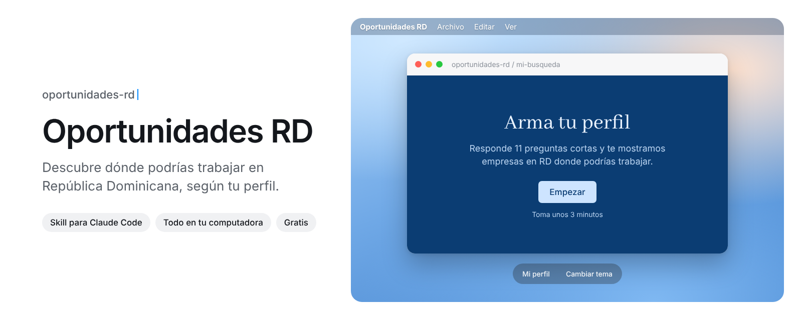
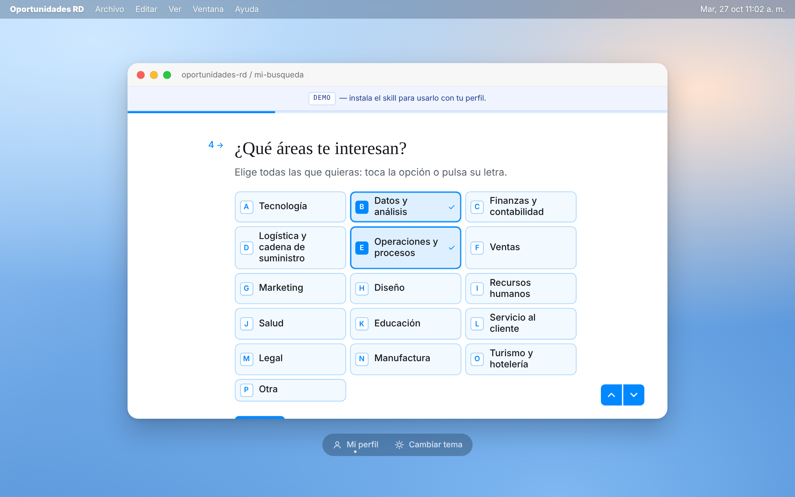

**Español** · [English](README.en.md)



Encuentra empresas en República Dominicana donde podrías trabajar según tu perfil, aunque hoy no
tengan vacantes publicadas.

**[Prueba la demo](https://alejandrocimentada.github.io/oportunidades-rd/)** · [Instálalo](#cómo-usarlo-la-forma-más-fácil)

## Qué hace

1. **Llenas tu perfil** en unas preguntas cortas (unos 3 minutos).
2. **Tu agente de IA busca empresas** con presencia en RD que encajan contigo. Cada una viene con una
   fuente que lo confirma.
3. **Te explica por qué encajan**: qué equipos, qué roles podrías tener y cómo postular.
4. **Revisa si tienen vacantes abiertas.**
5. **Si una te interesa**, te prepara un mensaje y una carta. Tú decides si los envías.

Todo se guarda en tu computadora. No envía nada por ti, no entra a LinkedIn ni a otros portales de
empleo y no guarda datos de otras personas.



## Cómo usarlo (la forma más fácil)

Necesitas [Claude Code](https://code.claude.com/docs/es/quickstart), un asistente de IA que trabaja
en tu computadora. No hace falta saber programar.

1. Abre Claude Code y pega este mensaje:

   ```text
   Instala el skill oportunidades-rd desde https://github.com/alejandrocimentada/oportunidades-rd y ábreme el panel.
   ```

2. Llena tu perfil en el panel que se abre en tu navegador.
3. Escríbele a Claude Code: **«Busca empresas en RD para mi perfil»**.

Después puedes pedirle cosas como:

> ¿Qué equipos de Empresa X encajan conmigo?
> Revisa si estas empresas tienen vacantes abiertas.
> Prepárame el mensaje y la carta para Empresa X.

Tus empresas y su seguimiento también quedan en un Excel (`data/oportunidades.xlsx`), que se
actualiza solo.

## Preguntas frecuentes

**¿Cuesta dinero?** El proyecto es gratis. Claude Code depende de tu plan de Claude.

**¿Dónde están mis datos?** Solo en tu computadora: el perfil en `~/.config/oportunidades-rd/` y las
empresas en la carpeta `data/` del proyecto.

**¿Por qué no da una puntuación a cada empresa?** Porque un número da una falsa precisión. Ves las
razones y las señales de alerta, y decides tú.

**Vi una vacante en LinkedIn o Computrabajo.** Esos portales no se revisan solos. Copia el texto y
pégaselo a tu agente: queda guardado con esa empresa.

---

## Para desarrolladores

Es un skill para agentes de IA (Claude Code, Codex y otros compatibles con `SKILL.md`) más una
aplicación en Python: scripts de línea de comandos, una base SQLite, un panel local en Flask y el
Excel. El agente sigue [`SKILL.md`](SKILL.md).

<details>
<summary><b>Instalación manual</b></summary>

Requiere Python 3.10 o superior.

```bash
# macOS / Linux
git clone https://github.com/alejandrocimentada/oportunidades-rd.git
mkdir -p ~/.claude/skills/oportunidades-rd
cp -R oportunidades-rd/. ~/.claude/skills/oportunidades-rd/
pip install -r ~/.claude/skills/oportunidades-rd/requirements.txt
```

```powershell
# Windows (PowerShell)
git clone https://github.com/alejandrocimentada/oportunidades-rd.git
New-Item -ItemType Directory -Force "$HOME\.claude\skills\oportunidades-rd" | Out-Null
Copy-Item -Recurse -Force "oportunidades-rd\*" "$HOME\.claude\skills\oportunidades-rd\"
pip install -r "$HOME\.claude\skills\oportunidades-rd\requirements.txt"
```

Para Codex, usa `~/.codex/skills/` en lugar de `~/.claude/skills/`.

</details>

<details>
<summary><b>Comandos</b></summary>

| Comando | Para qué |
|---|---|
| `python app.py` | Panel del perfil en <http://localhost:8765> (solo tu computadora) |
| `scripts/perfil.py show \| set <clave> <valor> \| sugerir` | Ver y cambiar el perfil |
| `scripts/empresas.py guardar --archivo empresas.json` | Guardar empresas (cada una necesita una fuente de presencia en RD) |
| `scripts/empresas.py list \| show \| estado \| nota` | Ver empresas y su seguimiento |
| `scripts/empresas.py generar <empresa> --rol <rol>` | Mensaje y carta |
| `scripts/rastrear.py` | Revisar vacantes abiertas (respeta robots.txt, 1 petición cada 3 s por sitio) |
| `scripts/exportar.py` | Regenerar el Excel |
| `scripts/construir_demo.py` | Rehacer la demo estática en `docs/` |
| `python -m pytest` | Pruebas (sin internet) |

</details>

## Créditos: ESCO

> This service uses the ESCO classification of the European Commission.

Las sugerencias de habilidades usan [ESCO](https://esco.ec.europa.eu/es) v1.2.1, la clasificación
europea de habilidades y ocupaciones, con licencia
[CC BY 4.0](https://creativecommons.org/licenses/by/4.0/deed.es). **Versión adaptada:** usamos un
subconjunto, con algunos nombres reescritos y habilidades curadas que no son de ESCO (detalles en
`scripts/construir_esco.py`). La Comisión Europea no respalda este proyecto.

## Licencia

[MIT](LICENSE) © 2026 Alejandro Cimentada. Proyecto independiente, sin relación con las empresas o
portales que menciona.
